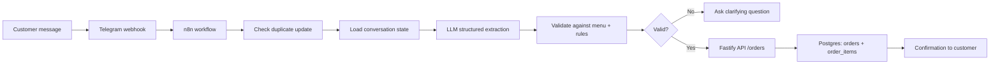
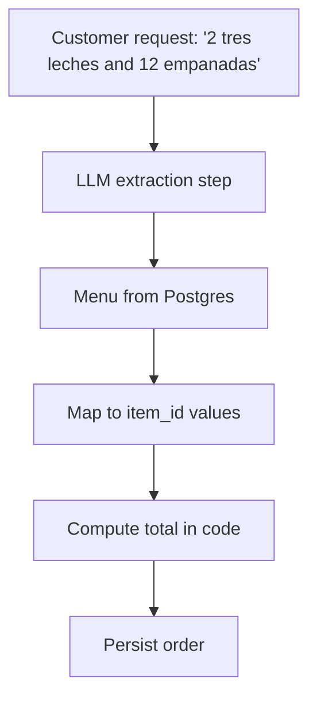
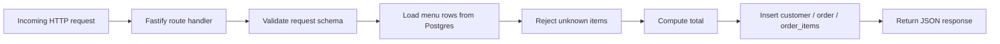
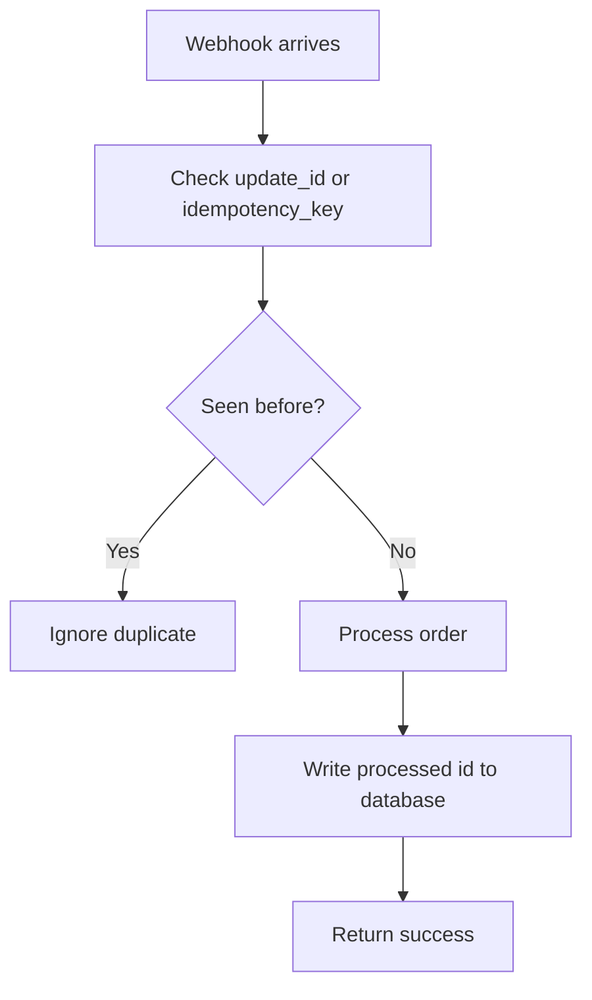
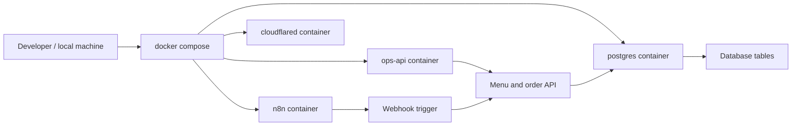
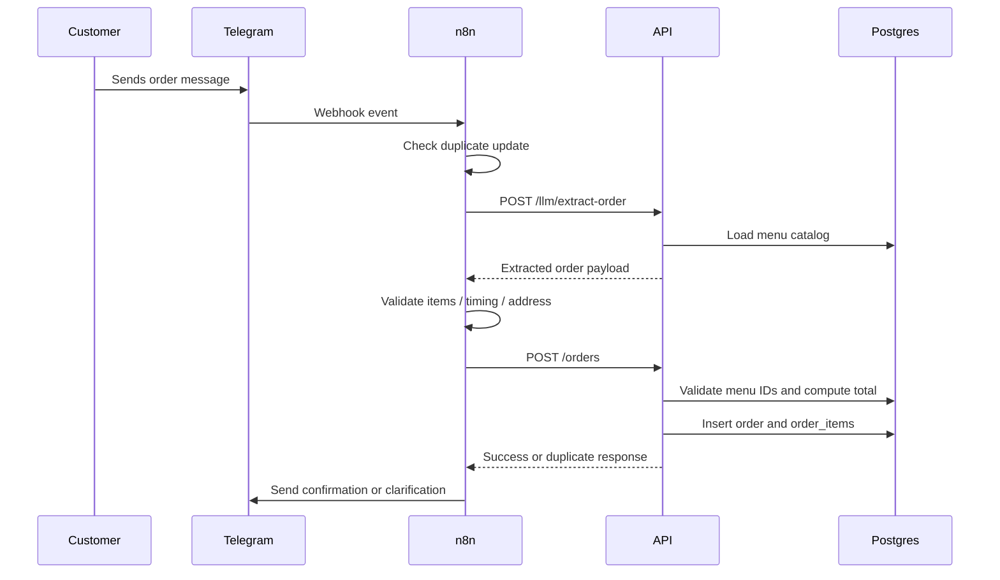

# Pastry Ops Automation — Stage 1 Overview

This project is a lean, interview-friendly MVP for a pastry order automation system. It teaches the most important patterns for AI workflow work:

- webhooks and event-driven automation
- grounding an LLM in a real database
- structured extraction and validation
- business rules in code instead of in AI prompts
- duplicate prevention and idempotency
- orchestration with n8n and a durable backend with Postgres

The core idea is simple: the AI helps interpret the customer request, but the database and backend service decide what is allowed, what is valid, and what the final price is.

---

## 1. System overview

The user interacts with a Telegram-style order request. The automation stack receives the message, validates it, loads the real menu from Postgres, checks the order for duplicates, and then stores the order in the database.

This is the mental model behind the whole system:

- n8n orchestrates flow and integrations
- the Fastify API owns business logic and persistence
- Postgres is the source of truth
- the LLM is used for interpretation, not for pricing or policy decisions

---

## 2. Why this architecture is used

The pattern here is intentionally split by responsibility:

- n8n: workflow orchestration, triggers, branches, logic, automation steps
- Fastify API: validation, menu checks, pricing, order creation, status updates
- Postgres: durable state, menu, orders, customers, dedupe keys, conversation state
- LLM: language understanding and structured extraction only

This split is important in interviews because it shows that you understand the difference between orchestration and business logic.

A good interview answer is:

> n8n handles the workflow; the backend handles the rules. The LLM interprets text. The database decides the truth. If a system is making pricing, validation, or record writes without code checks, it is not production-safe.

---

## 3. The most important concept: grounding

One of the most important practices in this project is grounding the LLM in real data.

The LLM is not given free reign to invent items or prices. Instead, the app uses the actual menu from Postgres and asks the model to map the request to known menu items.

### Grounding rules in this project

- menu items live in Postgres
- item IDs are the real identifiers used in orders
- the model gets menu context, not a free-form product catalog
- prices are computed in code using the stored database values
- the LLM never decides the final total

This is a common interview pattern: if an LLM can choose price, stock, or delivery logic, hallucination and fraud risk rise quickly.

---

## 4. How the server works

The Fastify server is the business layer. It is the place where rules are enforced.

### Main server responsibilities

- health check endpoint
- menu retrieval
- order creation
- order query by id
- order status update
- validation of structured payloads with Zod
- total calculation before saving

### Request lifecycle

The server runs in a simple loop:

1. Receive the HTTP request
2. Validate it with Zod
3. Query the database for product metadata
4. Reject invalid or unknown items
5. Calculate the total in code
6. Insert data into the correct tables
7. Return a stable JSON response

This is a good architecture to explain in interviews because it shows discipline and guardrails.

---

## 5. Idempotency and duplicate protection

Webhook systems are retry-prone. Telegram or external systems can send the same event more than once. The app handles that by storing processed IDs and using idempotency keys.

### Why this matters

- duplicate webhooks must not create duplicate orders
- network retries happen in the real world
- idempotency is a production concept, not a nice-to-have

In this project, the system stores the update or a generated idempotency key and refuses to process the same payload twice.

---

## 6. Conversation state and workflow memory

The project stores conversation state in Postgres instead of keeping states inside the n8n workflow memory. That is a major pattern for robust systems.

### Why keep state in Postgres?

- retries are safer
- state survives agent or workflow restarts
- the business can inspect the conversation later
- the same system can support multiple channels later

This means your conversation data is not ephemeral. It is part of the operational system.

---

## 7. Docker: why it matters here

Docker is not just for convenience. It makes the system reproducible and clear to reason about.

This project uses Docker Compose to run:

- Postgres for durable application state
- n8n for automation orchestration
- Fastify API for business logic
- cloudflared for exposing local services externally

### What Docker gives you

- one command to bring up the stack
- isolated runtime environments
- consistency across machines
- easier interview explanation of deployment architecture

The important interview point is that Docker is a packaging and runtime tool, not the business logic itself.

---

## 8. How the order flow works in practice

A full order starts with a customer message and ends with a saved order.

This is a great story to tell in interviews because it shows you understand the end-to-end flow, not just the individual tools.

---

## 9. Core patterns to emphasize in interviews

### Pattern 1: The LLM is for interpretation, not authority
The model is useful for understanding messy human requests. It should not decide the rules.

### Pattern 2: The database is the source of truth
Prices, menu items, and order history live in Postgres.

### Pattern 3: Validation happens before write operations
Before creating an order, the system validates item IDs, quantity, and delivery details.

### Pattern 4: Duplicate webhooks are normal
Idempotency is part of production correctness.

### Pattern 5: n8n is orchestration, not business logic
n8n moves data between systems. The actual business logic belongs in code.

---

## 10. Relevant files in this repo

### Root files

- [docker-compose.yml](docker-compose.yml) — local orchestration of Postgres, n8n, and the API
- [.env.example](.env.example) — environment variables and service config
- [README.md](README.md) — overview and study guide

### Database

- [db/init.sql](db/init.sql) — schema and menu seed data

### Backend service

- [ops-api/src/server.ts](ops-api/src/server.ts) — validation, order creation, menu queries, health checks
- [ops-api/package.json](ops-api/package.json) — dependency and script setup

### Workflow exports

- [n8n/workflows/order-intake.json](n8n/workflows/order-intake.json) — message intake and order workflow
- [n8n/workflows/daily-prep-list.json](n8n/workflows/daily-prep-list.json) — scheduled prep summary

---

## 11. Key interview answer

A strong interview answer to summarize the project is:

> This system uses n8n to orchestrate customer messages, a Fastify API to enforce business rules, and Postgres to keep the real product and order data. The LLM only extracts structured intent from natural language. The server validates item IDs, calculates totals from the menu, and prevents duplicate orders with idempotency checks. Docker makes the whole stack reproducible and easy to reason about.

---

## 12. Next step for practice

If you are studying for an interview, practice explaining the system in three layers:

1. what the customer sees
2. what the workflow does
3. what the backend and database enforce

That framework makes your explanation feel polished and production-aware.

---

## 13. Useful reference links

- Fastify docs: https://fastify.dev/docs/latest/
- Zod docs: https://zod.dev/
- PostgreSQL docs: https://www.postgresql.org/docs/
- Docker Compose docs: https://docs.docker.com/compose/
- n8n docs: https://docs.n8n.io/
- Telegram webhook docs: https://core.telegram.org/bots/webhooks
- Claude structured outputs: https://docs.claude.com/en/docs/build-with-claude/structured-outputs

This project is intentionally minimal, but the architecture teaches the exact patterns that matter in AI automation interviews: grounding, validation, separation of concerns, correctness, and operational reliability.
